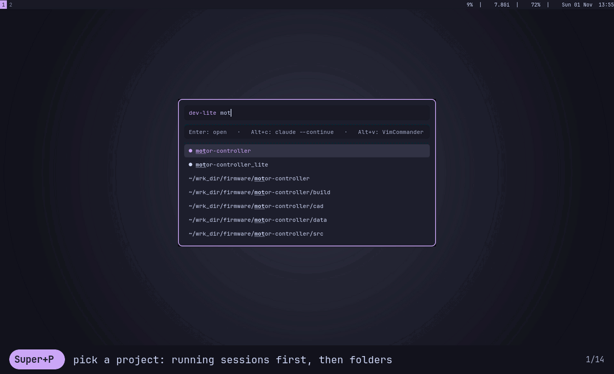
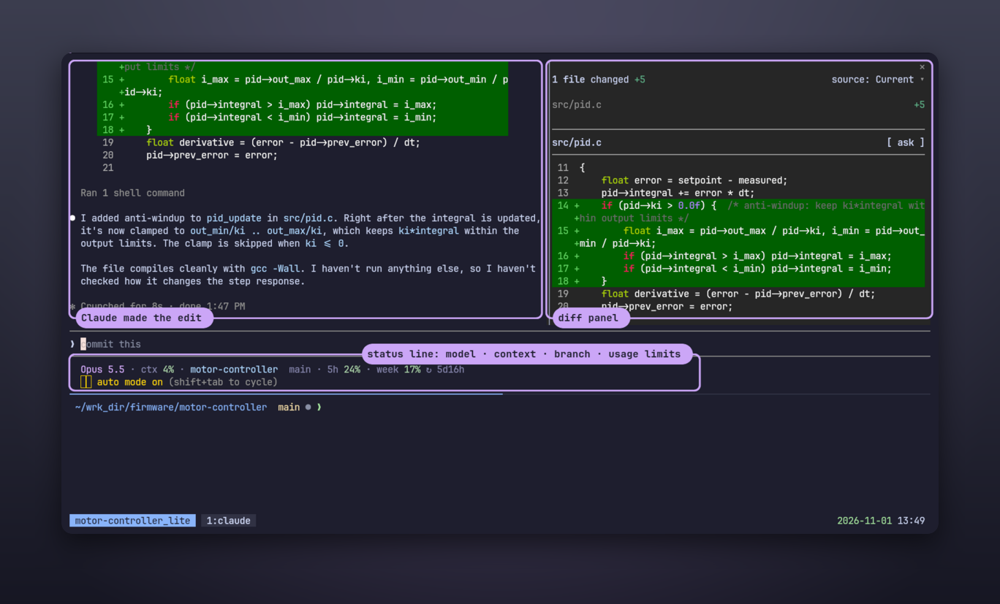
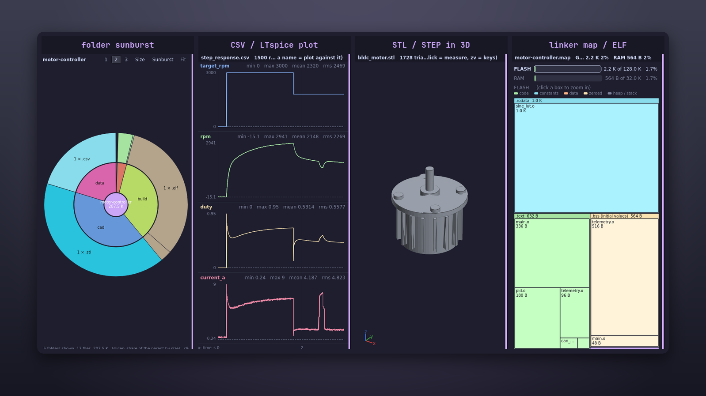
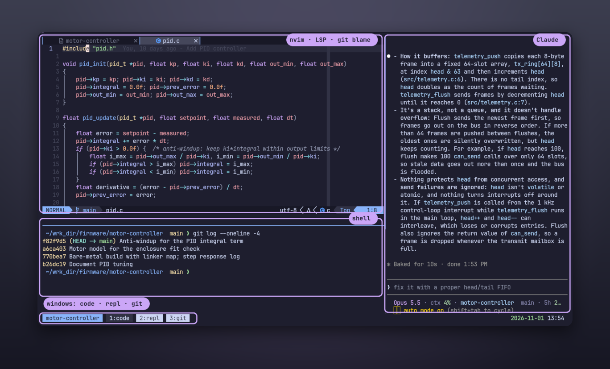
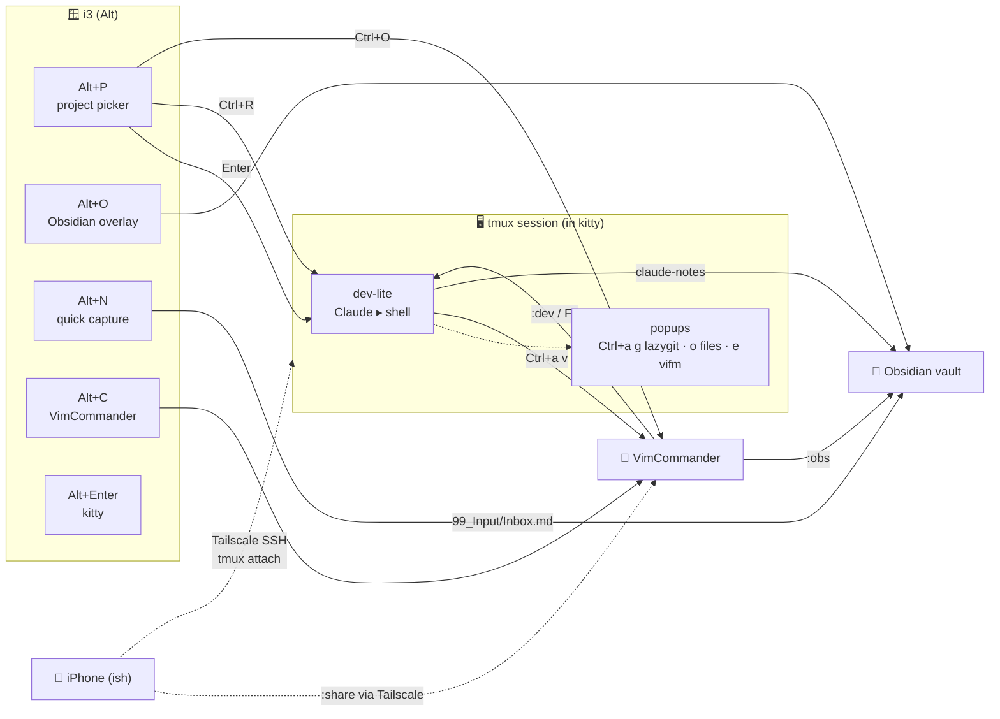
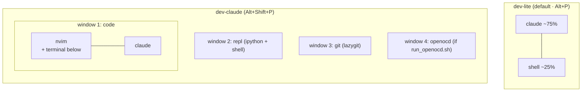
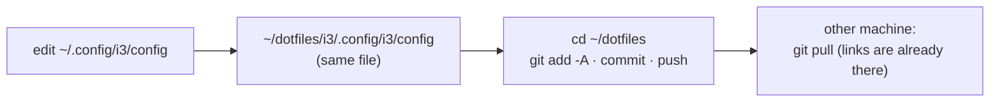
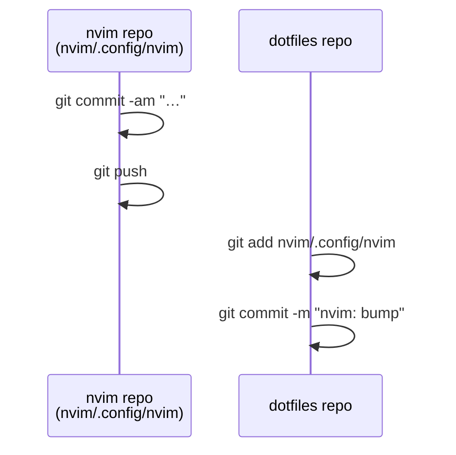
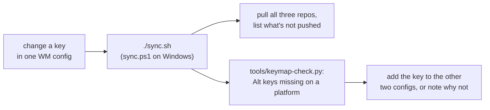

# dotfiles

My Linux workstation: **i3 + tmux + Claude Code + kitty**, with Obsidian for notes,
VimCommander for files and Tailscale to reach it all from the phone.
Catppuccin Mocha everywhere. Ubuntu 22.04 on a ThinkPad.

Managed with [GNU Stow](https://www.gnu.org/software/stow/). nvim is a git submodule
([Neovim_lua_config](https://github.com/vim4all/Neovim_lua_config)).

Same keys and look on the other two platforms:
[dotfiles-windows](https://github.com/vim4all/dotfiles-windows) (GlazeWM, Flow Launcher; terminal work in WSL with this repo) and
[dotfiles-macos](https://github.com/vim4all/dotfiles-macos) (AeroSpace; tmux, nvim, kitty from this repo).
See [Three platforms](#three-platforms).



- [Quick start](#quick-start)
- [Screenshots](#screenshots)
- [How it fits together](#how-it-fits-together)
- [Cheat sheet](#cheat-sheet): [key rules](#key-rules) · [i3](#i3--alt) · [project picker](#project-picker) · [tmux](#tmux--ctrl-and-prefix-ctrla) · [dev workspaces](#dev-workspaces) · [key cheat sheet](#key-cheat-sheet) · [Claude](#claude-code) · [kitty](#kitty) · [VimCommander](#vimcommander) · [Obsidian](#obsidian) · [bash](#bash) · [git](#git) · [ssh](#ssh) · [nvim](#nvim--leader-space)
- [Managing the dotfiles](#managing-the-dotfiles): [nvim submodule](#nvim-submodule) · [three platforms](#three-platforms)
- [Packages](#packages)

---

## Quick start

```bash
git clone --recurse-submodules git@github.com:vim4all/dotfiles.git ~/dotfiles
cd ~/dotfiles
./install.sh --deps      # apt packages, kitty, tmux TPM, then link everything
```

Then open tmux and press `Ctrl+a I` to install the tmux plugins, and log into i3.

| Command | Does |
|---|---|
| `./install.sh` | (re)link every package into `$HOME` |
| `./install.sh i3 kitty` | link only these packages |
| `./install.sh --deps` | install dependencies first |
| `sudo system/setup.sh` | the `/etc` settings stow can't link: zram swap, battery limit, Docker and journal log caps, keyboard, delta |
| `./sync.sh` | pull this repo and the Windows / macOS ones next to it, check their keys still match ([three platforms](#three-platforms)) |

It also creates the [local files](#local-never-committed) that are not in this public repo.

`install.sh` never overwrites a real file: if one is in the way it lists it and stops.

---

## Screenshots

**Claude Code in a dev-lite session.** Claude makes the change and shows the diff. The status line
shows model, context, branch and usage limits.



**VimCommander quick view** (`Ctrl+Q`, `zp` for plots): folder sunburst, CSV and LTspice plots,
STL and STEP models in 3D, firmware memory maps from a linker `.map` or ELF.



**The full layout** (`Alt+Shift+P`): nvim, a shell and Claude in one window, plus repl and git windows.



<sub>Recorded in a throwaway demo home with a made-up firmware project; Claude's answers are real.</sub>

---

## How it fits together



**A typical day:** `Alt+P` → pick a project → a tmux session opens with Claude on top
and a shell below. Git in a popup (`Ctrl+a g`), files in a popup (`Ctrl+a o`, `Ctrl+a e`) or in
VimCommander (`Ctrl+a v`). Ideas go to Obsidian with `Alt+N`. After a reboot,
tmux restores every session and Claude continues its last conversation.

---

## Cheat sheet

### Key rules

Each modifier belongs to one layer, so the modifier tells you who handles the key.

| Modifier | Layer | For |
|---|---|---|
| `Alt` (Option on macOS) | desktop (i3 / GlazeWM / AeroSpace) | windows, workspaces, apps, system |
| `Ctrl+H J K L` | tmux + nvim | moving between panes and nvim splits |
| `Ctrl+a`, then a letter | my tools | lazygit, files, scripts … |
| `Ctrl+a`, then `Ctrl`+letter | tmux itself | windows, splits, sessions, kill |
| `Ctrl` | the app or picker in front | its own keys; picker actions (they work on the phone too) |
| `Super` / `Win` / `Cmd` | the OS | `Super+Space` switches keyboard layout us ↔ ua (as on Windows) |

`Alt` is the only window-manager modifier that works on Linux, Windows and macOS, so the desktop owns it
and tmux stays off it. The same rules apply on Windows (GlazeWM) and macOS (AeroSpace); see
[dotfiles-windows](https://github.com/vim4all/dotfiles-windows) and [dotfiles-macos](https://github.com/vim4all/dotfiles-macos).

- `Shift` means *move*, *the other variant* or *careful*: `Alt+Shift+H` moves a window, `Alt+Shift+P` opens the full layout, `Alt+Shift+Q` closes.
- The layers mirror each other: `Alt+H J K L` / `Ctrl+H J K L` move between windows / panes; `Alt+/` / `Ctrl+a /` show this cheat sheet.
- The phone menu (`Ctrl+a m`) uses the same letters as `Ctrl+a`, then a letter.
- In bash, word moves are `Ctrl+←/→` and fzf cd is `Ctrl+G` (`Alt+F B D` belong to the window manager).

### i3 · `Alt`

**Apps**

| Key | Action |
|---|---|
| `Alt+Enter` | terminal (kitty; gnome-terminal on VNC `:1` or if kitty fails) |
| `Alt+D` / `Alt+Tab` | app launcher / window switcher (rofi) |
| `Alt+P` / `Alt+Shift+P` | [project picker](#project-picker) → **dev-lite** / full layout |
| `Alt+O` | Obsidian overlay, show / hide |
| `Alt+N` | quick capture → `99_Input/Inbox.md` |
| `Alt+C` | VimCommander |
| `Alt+/` | key cheat sheet |

**Windows and workspaces**

| Key | Action |
|---|---|
| `Alt+H J K L` / `+Shift` | focus / move (arrows work too) |
| `Alt+1…0` / `+Shift` | go to / move window to workspace |
| `Alt+Esc` | previous workspace (so does pressing the current workspace's number) |
| `Alt+Shift+Q` | close window |
| `Alt+F` | fullscreen |
| `Alt+B` / `Alt+V` | next window opens to the right / below |
| `Alt+S` · `W` · `E` | stacking · tabbed · toggle split |
| `Alt+Shift+Space` / `Alt+Space` | float / unfloat · focus tiling ↔ floating |
| `Alt+-` / `+Shift` | scratchpad: show / move window there |
| `Alt+R` | resize mode (`H J K L`, `Esc` to leave) |

**System**

| Key | Action |
|---|---|
| `Alt+Backspace` / `+Shift` / `+Ctrl` | notification: close / bring the last one back / close all |
| `Alt+Shift+X` | lock (also after 10 min idle and on suspend) |
| `Alt+F7` | re-apply monitor layout (after plugging monitors in or out) |
| `Alt+F8` | Bluetooth menu |
| `Alt+F9` / `Alt+F10` | unmount / mount Google Drive |
| `Super+Space` or ``Alt+` `` | keyboard layout us ↔ ua |
| `Print` / `Alt+Print` | screenshot area / screen (flameshot) |
| `Alt+Shift+C` · `R` · `E` | reload · restart · exit i3 |

Over VNC, the `Alt` keys reach i3 without fullscreen; TigerVNC fullscreen (`Ctrl+Alt+Enter`) also passes `Super` keys through.

### Workspaces

Each workspace has a fixed job and monitor (VGA | DP main | laptop). Apps open on theirs automatically;
with fewer screens (undocked, VNC) everything falls back to the one available.

| Key | Workspace | Monitor | Auto-assigned |
|---|---|---|---|
| `Alt+1` | `1: dev` | VGA (left) | |
| `Alt+2` | `2: dev` | DP (main) | |
| `Alt+3` | `3: ref` | laptop | |
| `Alt+4` | `4: web` | DP | |
| `Alt+5` | `5: chat` | laptop | Telegram, Discord, Thunderbird (tabbed; Telegram + Discord start at login) |
| `Alt+6` | `6: media` | VGA | mpv, VLC, Spotify |
| `Alt+7` | `7: eda` | DP | KiCad, STM32CubeMX |
| `Alt+8` `9` | spare | any | |
| `Alt+0` | `10: sys` | laptop | monitoring: btop, lazydocker |

Change the map in `i3/.config/i3/config` (`App → workspace` section); `xprop WM_CLASS` shows a window's class.

### Project picker

`Alt+P` lists, top to bottom: running tmux sessions (`● name  ·  folder`), projects in `~/wrk_dir/<group>/`
(as `DCR/DCR_ESP32_Telemetry`), then up to 15 of zoxide's frecent folders.

| Key | Action |
|---|---|
| `Enter` | open: attach the session, or start a dev-lite workspace in the folder |
| `Ctrl+R` | the same with `claude --continue` (resume) |
| `Ctrl+O` | open the folder in VimCommander |
| `Ctrl+K` | kill the session (asks first) |

The terminal version, `dev` (opens by itself on an SSH login), has the same keys except `Ctrl+O`.
A session already on screen is focused, not opened twice. New terminals go to `2: dev` (main screen), then `1: dev`,
then `3: ref`, two per workspace.

### tmux · `Ctrl` and prefix `Ctrl+a`

**`Ctrl+H J K L`** moves between panes, into nvim splits too (no prefix). `Ctrl+←/→` stay free for the shell.

**`Ctrl+a`, then a letter: my tools**

| Key | Action |
|---|---|
| `t` | scratch shell popup |
| `g` | **lazygit** popup |
| `o` | **open a file**: fuzzy-pick it, edit it |
| `e` | **vifm** popup |
| `v` | **VimCommander** in this folder |
| `r` | **run a project script** (`run_*.sh`); `Ctrl+a r` `Enter` repeats the last one |
| `S` | **serial monitor**: pick a port → picocom (`Ctrl+B Ctrl+X` quits) |
| `w` | Pomodoro timer |
| `n` | full dev layout in this folder |
| `/` | key cheat sheet |

Tools open in the pane's folder. Close a popup with `exit` / `q`, or hide it with `Ctrl+a Ctrl+d`
(scratch and Pomodoro keep running).

`Ctrl+a r` finds `run_*.sh` in the pane's folder or a parent (else the session folder) and types it into the
window's idle shell pane (or a new one), so the output stays in view and Claude can read it.

**`Ctrl+a`, then (tmux itself, mostly `Ctrl`+letter):**

| Key | Action | | Key | Action |
|---|---|---|---|---|
| `Ctrl+t` | new window | | `Ctrl+g` / `h` or `Ctrl+h` | split side by side / top-bottom |
| `PgUp` / `PgDn` | previous / next window | | `j` `k` `←` `→` | select pane |
| `Ctrl+n` | new session | | `H J K L` | resize pane (repeatable) |
| `s` | **sessions**: list and switch | | `Ctrl+w` | kill pane |
| `Ctrl+o` | **session switcher** (fuzzy) | | | |
| `Ctrl+d` | detach | | `q` | kill session |
| `Enter` | copy mode (`v` select, `y` copy) | | `m` | phone menu |
| `Ctrl+s` / `Ctrl+r` | save / restore sessions | | `R` | reload config |
| `Ctrl+l` | clear the screen (`Ctrl+L` alone moves right) | | `I` | install plugins (TPM) |
| `?` | tmux's own key list | | | |

Mouse works everywhere; selecting text copies it. Sessions are saved every 5 minutes and **restored after a
reboot**: Claude panes come back as `claude --continue`, and i3 reopens a terminal for every session that was
on screen, on the same workspace (`i3/.config/i3/scripts/sessions.py`). No need to start `tmux` by hand.

### Dev workspaces



| Command | Layout |
|---|---|
| `dev-lite [DIR]` | Claude + shell (lazygit via `Ctrl+a g`) |
| `dev-claude [DIR]` | nvim + terminal + Claude, repl, git, openocd windows |
| `dev-plain [DIR]` | same without an AI pane |
| `dev-gemini [DIR]` | same with the Antigravity CLI |

Options: `-c` continue the last AI conversation · `DIR SESSION` custom session name ·
`-- ARGS` passed to the AI CLI (`dev-lite -- --model opus`). An existing session is just attached.

### Key cheat sheet

Forgot a key? **`Alt+/`** (rofi) or **`Ctrl+a /`** (tmux popup)
lists every i3 and tmux binding with a description and how often you've used it.
Type to search; in rofi, `Enter` runs an i3 binding.

Every key press is counted in `~/.local/state/keys/usage.log` (local, never committed).
To find bindings worth dropping:

| Command | Shows |
|---|---|
| `keys stats` | i3 + your tmux keys, least used first; red = never |
| `keys stats -u` | only the never-used ones |
| `keys stats -d 30` | the last 30 days |
| `keys stats -s` | also shell and git aliases, counted in bash history |

Descriptions live in the configs: a `#: text` line right above an i3 `bindsym`, and
`bind-key -N "text"` in tmux. A binding without one shows its command.

### Claude Code

| What | How |
|---|---|
| Claude with the Obsidian vault | `claude-notes` (vault rules in its `CLAUDE.md`) |
| Needs you / finished | desktop notification + bell → tmux window and i3 workspace get flagged |
| Which sessions wait | i3 bar, left: `⚠ name` needs a permission answer (red), `✓ name` finished (goes away once you focus it); click → jump to it |
| Full layout for this project | `Ctrl+a n` in tmux (nvim + shell + Claude) |
| Status line | model · context % · project/branch · 5 h and weekly limits |
| Resume after reboot | automatic (tmux-resurrect → `claude --continue`) |
| From the phone | iSH → `ssh` over Tailscale → the picker opens by itself (see *Phone* below) |

### Phone (iSH over SSH)

- **Login opens the picker** (`dev`, the [project picker](#project-picker) in fzf): `Enter` open ·
  `Ctrl+R` resume Claude · `Ctrl+K` kill · `Esc` plain shell. Skip it once with `ssh -t host 'DEV_NO_PICKER=1 bash -l'`.
- **`Ctrl+a m` menu**: the same tools full screen, same letters as `Ctrl+a`, then a letter:
  `t` scratch · `g` lazygit · `o` open file · `e` vifm · `r` run script · `S` serial · `w` Pomodoro · `/` keys;
  then tmux: `z` zoom · `s` sessions · `n` next window · `d` detach.
- **Auto-zoom**: while an SSH client under 120 columns looks at a window, its Claude pane is zoomed;
  it unzooms when the phone detaches (`Ctrl+a z` on the phone keeps it unzoomed). tmux 3.2 has no
  hook for "the desktop is active again", so with both attached the desktop sees the zoom too.
- **Colours**: over SSH `TERM=xterm` (iSH) becomes `xterm-256color`.

### ESP-IDF via direnv

ESP32 projects have a `.envrc` with `use esp_idf`: `cd` in and `idf.py`, the Xtensa toolchain and OpenOCD
are on `PATH` (also for Claude in the dev-lite pane); `cd` out and they're gone. The first load caches the
environment per IDF commit (`~/.cache/direnv-esp-idf/`), so after that it's instant. New project:
`echo 'use esp_idf' > .envrc && direnv allow`. `.envrc` is in the global git ignore.

### kitty

| Key | Action |
|---|---|
| `Ctrl+Shift+C` / `Ctrl+Shift+V` | copy / paste |
| `Ctrl+=` / `Ctrl+-` / `Ctrl+0` | font bigger / smaller / reset |
| `Ctrl+click` | open link |
| `Ctrl+Shift+F5` | reload config |
| `Ctrl+Shift+A`, then `1` · `D` · `M` / `L` | background: solid · back to 93 % · more / less opaque |

### VimCommander

My additions on top of its [own keys](https://github.com/vim4all/VimCommander#key-reference):

| Key / command | Action |
|---|---|
| `F9` / `:dev` | dev-lite workspace in this folder |
| `:devc` | same with `claude --continue` |
| `F10` / `:lg` | lazygit in kitty |
| `:obs` | open the file in Obsidian |
| `S` | kitty here |
| `:share` | QR code for the phone: same Wi-Fi, or pick the `100.x` Tailscale address |
| bar | wrk_dir · Vault · Terminal · Claude |

### Obsidian

| What | How |
|---|---|
| show / hide | `Alt+O` (centered overlay on any workspace) |
| capture a thought | `Alt+N`, type, `Enter` → `99_Input/Inbox.md` with a timestamp |
| triage the inbox | `claude-notes`, then "sort my Inbox" |

### bash

| Command | Does |
|---|---|
| `z NAME` | jump to a frecent folder (zoxide) |
| `mkcd DIR` | create and enter |
| `extract FILE` | unpack any archive |
| `vifm` | file manager, cd to the last folder on exit |
| `ll` · `la` · `..` · `...` | listings, go up |
| `duh` · `path` · `week` | disk usage · PATH · ISO week |

Prompt: `path [branch ●] [venv] ❯`, history shared live between terminals,
`↑` / `↓` search history by the typed prefix, `Ctrl+←/→` jump by word. Start a command with a space to keep it
out of history.

**fzf**, anywhere at the prompt:

| Key | Does |
|---|---|
| `Ctrl+R` | fuzzy-search history, `Enter` puts the command on the prompt |
| `Ctrl+T` | insert a file path mid-command (`scp ` `Ctrl+T`), with a preview |
| `Ctrl+G` | cd into a subfolder |
| `**` `Tab` | fuzzy completion: `vim src/**`, `kill **`, `ssh **` |

`bat` and `fd` are Ubuntu's `batcat` and `fdfind`.

### git

| Alias | Does |
|---|---|
| `git st` · `git lg` · `git last` | short status · graph log · last commit with files |
| `git amend` · `git undo` · `git unstage F` | add to last commit · uncommit (keep changes) · unstage |
| `git wip` | commit everything as `wip` |
| `git ds` · `git recent` | side-by-side diff · branches by last commit |

Diffs go through [delta](https://github.com/dandavison/delta) when installed (`n` / `N`
jump between files), plain `less` otherwise. `pull` rebases with autostash, `push` goes
to the same-named branch, conflicts show the base (`diff3`) and `rerere` remembers
resolutions.

### ssh

Connections are reused for 10 minutes (a second `ssh`, `scp` or `git push` to the same
host starts instantly) and kept alive through Wi-Fi/Tailscale drops. Hosts go in
`~/.ssh/config.local`, which has a commented example for a board that gets reflashed.

### nvim · leader `Space`

| Key | Action |
|---|---|
| `Space ff` / `Space fg` | find files / live grep |
| `Space e` | file tree |
| `Space w` / `Space q` | save / quit |
| `Space gg` | Neogit |
| `Space rn` / `Space ca` / `Space cf` | rename / code action / format |
| `Space db` / `Space dc` | breakpoint / start debugging |
| `Ctrl+H J K L` | move between splits and tmux panes (vim-tmux-navigator) |

Full list in [nvim's README](nvim/.config/nvim/README.md#keymaps).

---

## Managing the dotfiles

Every config in `$HOME` is a **symlink into this repo**, so editing a config edits the repo.



| Task | Commands |
|---|---|
| see what changed | `cd ~/dotfiles && git status` |
| save | `git add -A && git commit -m "…" && git push` |
| update another machine | `git pull --recurse-submodules` |
| add a new config | `mkdir -p btop/.config && mv ~/.config/btop btop/.config/ && stow btop` |
| unlink a package | `stow -D btop` |
| relink after a program replaced a link with a file | copy its changes into the repo, delete the file, `stow -R <package>` |

A new package also goes into `PACKAGES` in `install.sh` and the table below.

### nvim submodule

nvim keeps its own repository and history; this repo only records which commit to use.



```bash
cd ~/dotfiles/nvim/.config/nvim && git commit -am "…" && git push
cd ~/dotfiles && git add nvim/.config/nvim && git commit -m "nvim: bump"
git submodule update --remote nvim/.config/nvim     # pull the newest nvim config
```

### Three platforms

One desktop, three repos. Each holds what only its platform needs; the terminal side
(tmux, nvim, git, kitty, bash) lives here and is shared:

| Repo | Window manager | Picker | Terminal side | Install |
|---|---|---|---|---|
| [dotfiles](https://github.com/vim4all/dotfiles) (this one) | i3 | rofi | everything here | `./install.sh --deps` |
| [dotfiles-windows](https://github.com/vim4all/dotfiles-windows) | GlazeWM | Flow Launcher | this repo, in WSL | `.\install.ps1 -Deps` |
| [dotfiles-macos](https://github.com/vim4all/dotfiles-macos) | AeroSpace | Raycast | tmux, nvim, git, kitty, keys from this repo | `./install.sh --deps --shared` |

Keep them next to each other, in either layout:

```
~/dotfiles  ~/dotfiles-windows  ~/dotfiles-macos      # or  .../dotfiles/{linux,windows,macos}
```



| Command | Does |
|---|---|
| `./sync.sh` | fetch and fast-forward the three repos (dirty ones are left alone), list commits not pushed yet |
| `./sync.sh --clone` | also clone the ones missing next to this repo |
| `./sync.sh --push` | also push the clean ones that are ahead |
| `tools/keymap-check.py` | Alt keys that are not bound on every platform (`--all`: the full table, i3 · GlazeWM · AeroSpace) |

`sync.sh` is the same file here and in dotfiles-macos; Windows has `sync.ps1` (it runs git for this
repo inside WSL, because of the symlinks). kitty reads `linux.conf` or `macos.conf` next to
`kitty.conf`, so one config serves both.

---

## Packages

| Package | Links into `$HOME` | Contents |
|---|---|---|
| `bash` | `.bashrc`, `.profile` | shell options, prompt, aliases, `dev-*`, `claude-notes` |
| `git` | `.gitconfig`, `.config/git/ignore` | includes `~/.gitconfig.local` (name / e-mail, not in the repo); global ignores (`.envrc`, `settings.local.json`) |
| `i3` | `.config/i3/` | WM config + scripts (picker, Obsidian toggle, capture, terminal launcher, status) |
| `i3status` | `.config/i3status/` | bar blocks |
| `dunst` | `.config/dunst/` | notifications |
| `picom` | `.config/picom/` | compositor |
| `rofi` | `.config/rofi/` | launcher and picker theme |
| `kitty` | `.config/kitty/` | terminal (background 93 % opaque through picom); `linux.conf` / `macos.conf` per OS (Option as Alt on macOS) |
| `tmux` | `.config/tmux/`, `.tmux.conf` | tmux config, file picker script |
| `tmux_workspaces` | `.config/tmux_workspaces/` | dev workspace launchers, Pomodoro |
| `claude` | `.claude/settings.json`, `statusline.py`, `hooks/notify.py` | Claude Code settings |
| `vimcommander` | `.config/VimCommander/`, `.local/bin/vimcommander`, `.desktop` | VimCommander settings as `config.example.json`; `install.sh` makes `config.json` from it (app: [VimCommander](https://github.com/vim4all/VimCommander) in `~/src/VimCommander`) |
| `direnv` | `.config/direnv/lib/esp_idf.sh` | `use esp_idf` for `.envrc` files (cached ESP-IDF environment) |
| `vnc` | `.vnc/xstartup`, `.config/systemd/user/vncserver@.service` | TigerVNC session (i3) and a user unit to start it at boot: `systemctl --user enable --now vncserver@:1` + `loginctl enable-linger` |
| `ssh` | `.ssh/config` | generic defaults (connection reuse, keepalive); includes `~/.ssh/config.local` |
| `maint` | `.local/bin/pc-cleanup`, `pc-cleanup.timer` | monthly cleanup of unused Docker data, with a notification; `systemctl --user enable --now pc-cleanup.timer` |
| `keys` | `.local/bin/keys`, `keys-log` | key cheat sheet (`Alt+/`, `Ctrl+a /`) and usage counting (`keys stats`) |
| `nvim` | `.config/nvim/` | submodule → Neovim_lua_config |

### System settings (`system/`, not stowed)

Files under `/etc` belong to root, so `system/setup.sh` copies them in (with `sudo`; safe to run again):

| File | Does |
|---|---|
| `etc/default/zramswap` | ~8 GB compressed swap in RAM (zstd), so big builds slow down instead of being killed |
| `etc/udev/rules.d/90-battery-charge-limit.rules` | ThinkPad battery charges to 80 %, resumes below 75 % |
| `etc/docker/daemon.json` | container logs max 3 × 10 MB |
| `etc/systemd/journald.conf.d/size.conf` | system journal max 500 MB |

It also installs `ncdu` and [delta](https://github.com/dandavison/delta) (not packaged for Ubuntu 22.04),
sets the keyboard default to `us,ua` + `Super+Space` (a Bluetooth keyboard that reconnects would otherwise
come back as plain `us`) and keeps 2 snap revisions instead of 3.

### Local, never committed

This repo is public, so anything personal lives next to it, not in it:

| File | Holds | Created by |
|---|---|---|
| `~/.gitconfig.local` | git name and e-mail | `install.sh` (template) |
| `~/.config/VimCommander/config.json` | VimCommander settings + session state (open folders, history) | `install.sh`, from `config.example.json` |
| `~/.config/rclone/shared-drive.env` | optional shared Google Drive: `SHARED_DRIVE_ID`, `SHARED_MOUNT`, `SHARED_NAME` | you |
| `~/.config/rclone/rclone.conf` | Google tokens | `rclone config` |
| `~/.ssh/config.local` | your SSH hosts | `install.sh` (commented template) |
| `~/.vnc/passwd` | VNC password | `vncpasswd` |
| `~/.claude/.credentials.json`, `~/.claude.json`, history | Claude login and sessions | Claude Code |
| `**/.claude/settings.local.json` | per-project Claude permissions | Claude Code (git-ignored) |
| `~/.config/private-patterns` | regexes that must never be committed (e-mail, name, IPs) | `install.sh` (commented template) |

A pre-commit hook (`.githooks/pre-commit`, used here and in the nvim submodule) blocks a commit
when [gitleaks](https://github.com/gitleaks/gitleaks) finds a secret or a staged line matches
`~/.config/private-patterns`. `git commit --no-verify` overrides it once.

Changed a VimCommander setting worth keeping? Copy it into `config.example.json`
(use `@HOME@` for your home folder). Before pushing, `git diff --cached` is the last check
that nothing personal slipped in.

tmux plugins come from TPM. Only the generic `~/.ssh/config` is in the repo: keys, hosts and `~/.gnupg` never are.
