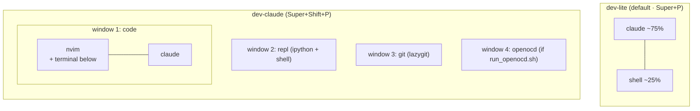
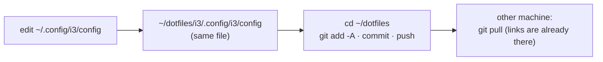
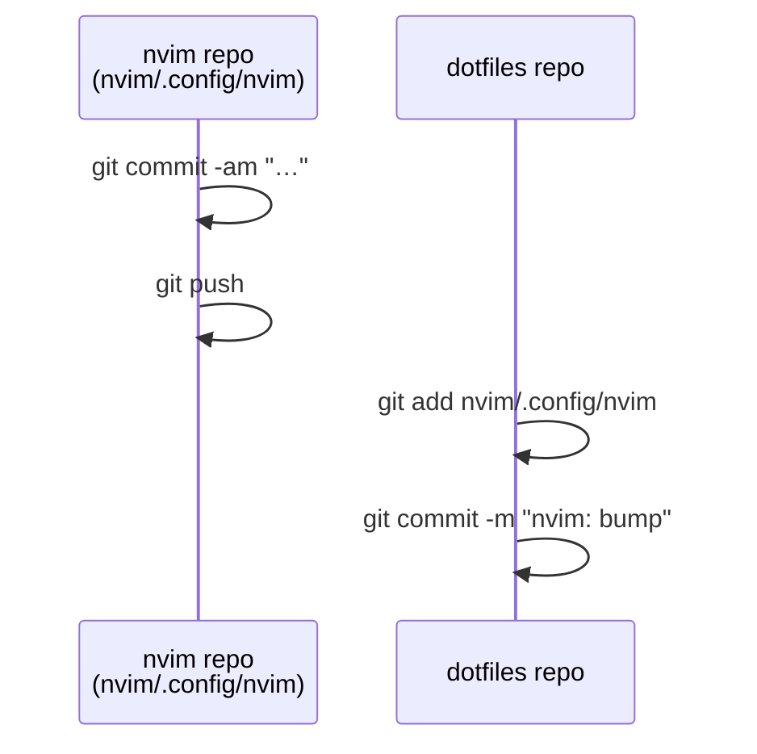

# dotfiles

My Linux workstation: **i3 + tmux + Claude Code + kitty**, with Obsidian for notes,
VimCommander for files and Tailscale to reach it all from the phone.
Catppuccin Mocha everywhere. Ubuntu 22.04 on a ThinkPad.

Managed with [GNU Stow](https://www.gnu.org/software/stow/). nvim is a git submodule
([Neovim_lua_config](https://github.com/vim4all/Neovim_lua_config)).

- [Quick start](#quick-start)
- [How it fits together](#how-it-fits-together)
- [Cheat sheet](#cheat-sheet): [i3](#i3--super) · [project picker](#project-picker) · [tmux](#tmux--prefix-ctrla) · [dev workspaces](#dev-workspaces) · [Claude](#claude-code) · [kitty](#kitty) · [VimCommander](#vimcommander) · [Obsidian](#obsidian) · [bash](#bash) · [nvim](#nvim--leader-space)
- [Managing the dotfiles](#managing-the-dotfiles)
- [Packages](#packages)

---

## Quick start

```bash
git clone --recurse-submodules git@github.com:vim4all/dotfiles.git ~/dotfiles
cd ~/dotfiles
./install.sh --deps      # apt packages, kitty, tmux TPM, then link everything
```

Then open tmux and press `Ctrl+a` `I` to install the tmux plugins, and log into i3.

| Command | Does |
|---|---|
| `./install.sh` | (re)link every package into `$HOME` |
| `./install.sh i3 kitty` | link only these packages |
| `./install.sh --deps` | install dependencies first |

It also creates the [local files](#local-never-committed) that are not in this public repo.

`install.sh` never overwrites a real file: if one is in the way it lists it and stops.

---

## How it fits together


**A typical day:** `Super+P` → pick a project → a tmux session opens with Claude on top
and a shell below. Git in a popup (`Alt+G`), files in a popup (`Ctrl+a f`) or in
VimCommander (`Ctrl+a C`). Ideas go to Obsidian with `Super+N`. After a reboot,
tmux restores every session and Claude continues its last conversation.

---

## Cheat sheet

### i3 · `Super`

| Key | Action |
|---|---|
| `Super+Enter` | terminal (kitty, falls back to gnome-terminal) |
| `Super+D` / `Super+Tab` | app launcher / window switcher (rofi) |
| `Super+P` / `Super+Shift+P` | project picker → **dev-lite** / dev-claude (full layout) |
| `Super+O` | Obsidian overlay, show / hide |
| `Super+N` | quick capture → `99_Input/Inbox.md` |
| `Super+C` | VimCommander |
| `Super+-` / `Super+Shift+-` | scratchpad show / move window there |
| `Super+H J K L` | focus (arrows work too) · add `Shift` to move |
| `Super+B` / `Super+V` | split horizontal / vertical |
| `Super+F` · `S` · `W` · `E` | fullscreen · stacking · tabbed · toggle split |
| `Super+Shift+Space` / `Super+Space` | floating toggle / focus tiling ↔ floating |
| `Super+R` | resize mode (`HJKL`, `Esc` to leave) |
| `Super+1…0` / `Super+Shift+1…0` | go to / move window to workspace |
| `Super+Shift+Q` | close window |
| `Super+Shift+X` | lock (also after 10 min idle and on suspend) |
| `Super+F8` | Bluetooth menu |
| ``Super+` `` / `Alt+Shift` | keyboard layout us ↔ ua |
| `Print` / `Super+Print` | screenshot area / screen (flameshot) |
| `Super+F9` / `Super+F10` | unmount / mount Google Drive |
| `Super+Shift+C` / `Super+Shift+R` / `Super+Shift+E` | reload / restart / exit i3 |
| `Ctrl+Space` / `Ctrl+Shift+Space` / ``Ctrl+` `` | notifications: close / close all / history |

Over VNC (Super is taken by the client): `Ctrl+Alt+Enter` terminal · `Ctrl+Alt+D` launcher ·
`Ctrl+Alt+Q` close · `Ctrl+Alt+P` / `Ctrl+Alt+Shift+P` picker · `Ctrl+Alt+O` Obsidian.

### Project picker

`Super+P` lists running tmux sessions (`● name`) first, then `~/wrk_dir/*/*` and zoxide's folders.

| Key | Action |
|---|---|
| `Enter` | open: attach the session, or start a dev-lite workspace in the folder |
| `Alt+C` | start it with `claude --continue` |
| `Alt+V` | open the folder (or the session's folder) in VimCommander |

### tmux · prefix `Ctrl+a`

**No prefix**

| Key | Action |
|---|---|
| `Alt+H J K L` / `Alt+arrows` | move between panes (passes through to nvim splits) |
| `Alt+G` | **lazygit** popup in the pane's folder |
| `Alt+T` | scratch shell popup |

**With `Ctrl+a` first**

| Key | Action | | Key | Action |
|---|---|---|---|---|
| `g` | split side by side | | `t` | new window |
| `h` | split top / bottom | | `PgUp` / `PgDn` | previous / next window |
| `w` | kill pane | | `n` | new session |
| `q` | kill session | | `o` | **session switcher** (fuzzy) |
| `j` `k` `←` `→` | select pane | | `Ctrl+d` | detach |
| `H J K L` | resize pane (repeatable) | | `D` | full dev layout here |
| `f` | **pick a file** (fzf) → editor | | `P` | Pomodoro popup |
| `e` | **vifm** popup | | `Ctrl+s` / `Ctrl+r` | save / restore sessions |
| `C` | **VimCommander** here | | `r` | reload config |
| `Enter` | copy mode (`v` select, `y` copy) | | `I` | install plugins (TPM) |

Mouse works everywhere; selecting text copies it to the clipboard.
Sessions are saved every 5 minutes and **restored automatically** after a reboot;
panes that ran Claude come back as `claude --continue`.

### Dev workspaces



| Command | Layout |
|---|---|
| `dev-lite [DIR]` | Claude + shell (lazygit via `Alt+G`) |
| `dev-claude [DIR]` | nvim + terminal + Claude, repl, git, openocd windows |
| `dev-plain [DIR]` | same without an AI pane |
| `dev-gemini [DIR]` | same with the Antigravity CLI |

Options: `-c` continue the last AI conversation · `DIR SESSION` custom session name ·
`-- ARGS` passed to the AI CLI (`dev-lite -- --model opus`). An existing session is just attached.

### Claude Code

| What | How |
|---|---|
| Claude with the Obsidian vault | `claude-notes` (vault rules in its `CLAUDE.md`) |
| Needs you / finished | desktop notification + bell → tmux window and i3 workspace get flagged |
| Status line | model · context % · project/branch · 5 h and weekly limits |
| Resume after reboot | automatic (tmux-resurrect → `claude --continue`) |
| From the phone | ish → `ssh` over Tailscale → `tmux attach` |

### kitty

| Key | Action |
|---|---|
| `Ctrl+Shift+C` / `Ctrl+Shift+V` | copy / paste |
| `Ctrl+=` / `Ctrl+-` / `Ctrl+0` | font bigger / smaller / reset |
| `Ctrl+click` | open link |
| `Ctrl+Shift+F5` | reload config |

### VimCommander

My additions on top of its [own keys](https://github.com/vim4all/VimCommander#key-reference):

| Key / command | Action |
|---|---|
| `F9` / `:dev` | dev-lite workspace in this folder |
| `:devc` | same with `claude --continue` |
| `F10` / `:lg` | lazygit in kitty |
| `:obs` | open the file in Obsidian |
| `S` | kitty here |
| `:share` | QR code for the phone: same Wi-Fi, or pick the `100.x` Tailscale address |
| bar | wrk_dir · Vault · Terminal · Claude |

### Obsidian

| What | How |
|---|---|
| show / hide | `Super+O` (centered overlay on any workspace) |
| capture a thought | `Super+N`, type, `Enter` → `99_Input/Inbox.md` with a timestamp |
| triage the inbox | `claude-notes`, then "sort my Inbox" |

### bash

| Command | Does |
|---|---|
| `z NAME` | jump to a frecent folder (zoxide) |
| `mkcd DIR` | create and enter |
| `extract FILE` | unpack any archive |
| `vifm` | file manager, cd to the last folder on exit |
| `ll` · `la` · `..` · `...` | listings, go up |
| `duh` · `path` · `week` | disk usage · PATH · ISO week |

Prompt: `path [branch ●] [venv] ❯`, history shared live between terminals,
`↑` / `↓` search history by the typed prefix.

### nvim · leader `Space`

| Key | Action |
|---|---|
| `Space ff` / `Space fg` | find files / live grep |
| `Space e` | file tree |
| `Space w` / `Space q` | save / quit |
| `Space gg` | Neogit |
| `Space rn` / `Space ca` / `Space cf` | rename / code action / format |
| `Space db` / `Space dc` | breakpoint / start debugging |

Full list in [nvim's README](nvim/.config/nvim/README.md#keymaps).

---

## Managing the dotfiles

Every config in `$HOME` is a **symlink into this repo**, so editing a config edits the repo.



| Task | Commands |
|---|---|
| see what changed | `cd ~/dotfiles && git status` |
| save | `git add -A && git commit -m "…" && git push` |
| update another machine | `git pull --recurse-submodules` |
| add a new config | `mkdir -p rofi/.config && mv ~/.config/rofi rofi/.config/ && stow rofi` |
| unlink a package | `stow -D rofi` |
| relink after a program replaced a link with a file | copy its changes into the repo, delete the file, `stow -R <package>` |

A new package also goes into `PACKAGES` in `install.sh` and the table below.

### nvim submodule

nvim keeps its own repository and history; this repo only records which commit to use.



```bash
cd ~/dotfiles/nvim/.config/nvim && git commit -am "…" && git push
cd ~/dotfiles && git add nvim/.config/nvim && git commit -m "nvim: bump"
git submodule update --remote nvim/.config/nvim     # pull the newest nvim config
```

---

## Packages

| Package | Links into `$HOME` | Contents |
|---|---|---|
| `bash` | `.bashrc`, `.profile` | shell options, prompt, aliases, `dev-*`, `claude-notes` |
| `git` | `.gitconfig` | includes `~/.gitconfig.local` (name / e-mail, not in the repo) |
| `i3` | `.config/i3/` | WM config + scripts (picker, Obsidian toggle, capture, terminal launcher, status) |
| `i3status` | `.config/i3status/` | bar blocks |
| `dunst` | `.config/dunst/` | notifications |
| `picom` | `.config/picom/` | compositor |
| `kitty` | `.config/kitty/` | terminal |
| `tmux` | `.config/tmux/`, `.tmux.conf` | tmux config, file picker script |
| `tmux_workspaces` | `.config/tmux_workspaces/` | dev workspace launchers, Pomodoro |
| `claude` | `.claude/settings.json`, `statusline.py`, `hooks/notify.py` | Claude Code settings |
| `vimcommander` | `.config/VimCommander/`, `.local/bin/vimcommander`, `.desktop` | VimCommander settings as `config.example.json`; `install.sh` makes `config.json` from it (app: [VimCommander](https://github.com/vim4all/VimCommander) in `~/src/VimCommander`) |
| `nvim` | `.config/nvim/` | submodule → Neovim_lua_config |

### Local, never committed

This repo is public, so anything personal lives next to it, not in it:

| File | Holds | Created by |
|---|---|---|
| `~/.gitconfig.local` | git name and e-mail | `install.sh` (template) |
| `~/.config/VimCommander/config.json` | VimCommander settings + session state (open folders, history) | `install.sh`, from `config.example.json` |
| `~/.config/rclone/shared-drive.env` | optional shared Google Drive: `SHARED_DRIVE_ID`, `SHARED_MOUNT`, `SHARED_NAME` | you |
| `~/.config/rclone/rclone.conf` | Google tokens | `rclone config` |
| `~/.claude/.credentials.json`, `~/.claude.json`, history | Claude login and sessions | Claude Code |
| `**/.claude/settings.local.json` | per-project Claude permissions | Claude Code (git-ignored) |

Changed a VimCommander setting worth keeping? Copy it into `config.example.json`
(use `@HOME@` for your home folder). Before pushing, `git diff --cached` is the last check
that nothing personal slipped in.

tmux plugins come from TPM; `~/.ssh` and `~/.gnupg` are never part of it.
